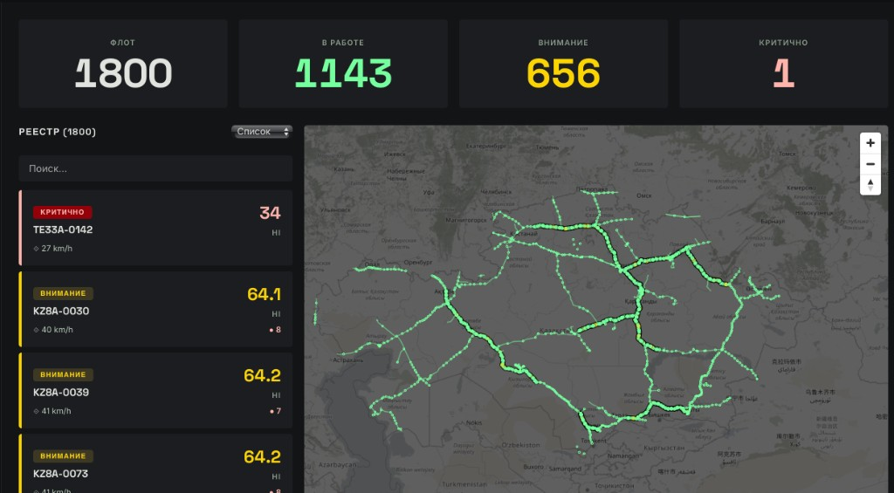
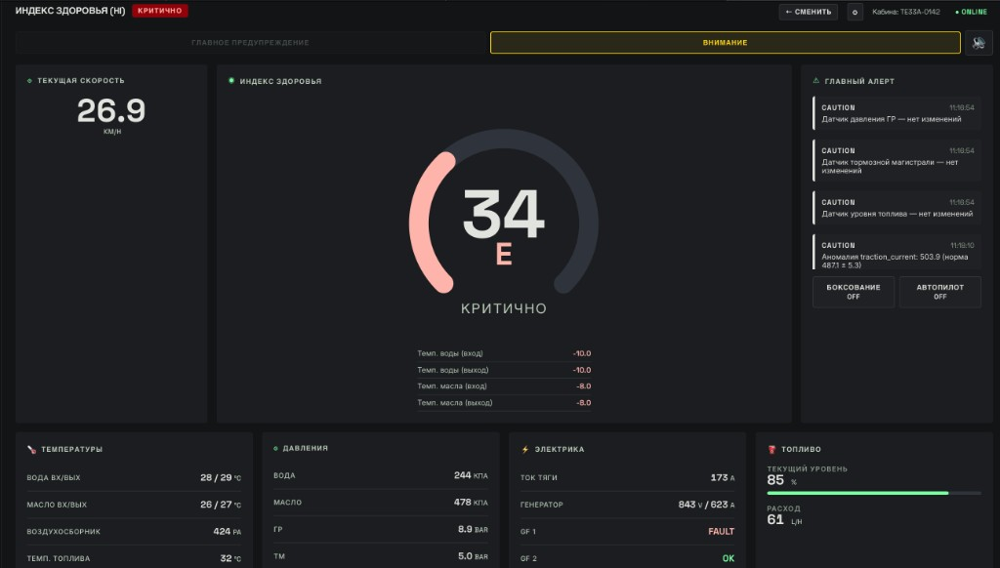
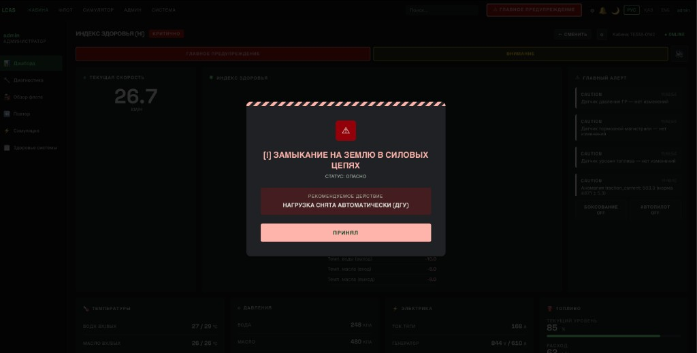
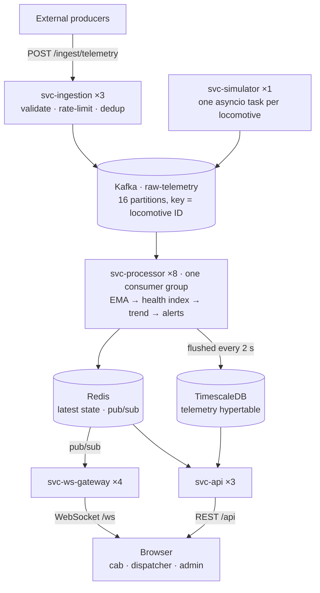

# LCAS — Locomotive Crew Alerting System

LCAS is a real-time telemetry and alerting system for a fleet of about 1,700 locomotives (TE33A diesel and KZ8A 25 kV electric). Telemetry enters Kafka (16 partitions, keyed by locomotive), where eight stream processors smooth each packet, compute a 0–100 health index over 13 weighted parameters with penalties for fault flags, extrapolate its trend to estimate the time to a critical state, and raise cockpit-style WARNING/CAUTION alerts. Results are pushed over WebSockets to the driver's cab view and the dispatcher's fleet map. The backend is a set of Python/FastAPI services on Kafka, Redis and TimescaleDB with a React frontend, and the whole system runs as 25 containers under Docker Compose.



| Cab view, cascade-failure scenario (HI 34, category E) | Full-screen WARNING: ground fault in the power circuits |
|---|---|
|  |  |

**Context:** built solo for a hackathon in 2026. The organizer's case brief (in Russian) is in [`docs/hackathon-task.pdf`](docs/hackathon-task.pdf); it asked for a real-time "digital twin" dashboard with a transparent 0–100 / A–E health index, updates visible within 500 ms, burst handling, history replay and report export.

**Language:** the UI, alert texts and voice prompts are in Russian (with a partial Kazakh/English label switch) because the users are local locomotive crews and dispatchers.

## Architecture



All client traffic enters through nginx on port 8000, which round-robins ingestion and API requests and pins WebSocket clients to a gateway with `ip_hash`.

| Service | Instances | Role |
|---|:-:|---|
| `svc-ingestion` | 3 | HTTP intake: Pydantic schema validation, 10 packets/s rate limit per locomotive, drops packets within 100 ms of the previous one, nulls physically impossible values, produces to Kafka |
| `svc-processor` | 8 | Kafka consumer group: smoothing, health index, prediction, alerts, anomalies → Redis and TimescaleDB |
| `svc-ws-gateway` | 4 | JWT-checked WebSocket fan-out from Redis pub/sub |
| `svc-api` | 3 | REST: fleet state, telemetry history, index configuration, CSV/JSON export, login |
| `svc-simulator` | 1 | TE33A and KZ8A models on 10 routes across Kazakhstan, fault-injection scenarios; publishes straight to Kafka |
| `nginx` | 1 | Entry point and load balancer (`backend/nginx.conf`) |
| `kafka`, `zookeeper` | 1 + 1 | Single Confluent 7.6 broker |
| `redis` | 1 | Latest state, pub/sub, rate-limit and dedup keys (1 GB, `allkeys-lru`) |
| `postgres` | 1 | TimescaleDB on PostgreSQL 16 |
| `frontend` | 1 | Vite dev server for the React app |
| **Total** | **25** | |

**Kafka.** Every packet goes to `raw-telemetry` (16 partitions) keyed by locomotive ID, so one locomotive's packets stay ordered on one partition and are always handled by the same processor. That is what lets the processors keep per-locomotive state (EMA, health-index history, active alerts) in memory; with eight processors, each owns two partitions. Two more topics, `processed-telemetry` (16 partitions) and `alerts` (8), are created at startup but not used yet.

**Per-message processing** in `backend/svc-processor/consumer.py`:

1. Exponential smoothing (α = 0.3) of every numeric sensor reading.
2. Health index and its top contributing factors (next section).
3. Trend extrapolation to the time at which the index would reach the critical boundary.
4. Threshold and fault-flag alerts, stuck-sensor checks, statistical anomalies.
5. Fuel efficiency relative to other locomotives at a similar speed (±15 km/h) on the same processor, and a data-quality score (share of missing or out-of-range readings).
6. One pipelined Redis round trip: set the latest state (30 s TTL) and active alerts (60 s TTL), then publish the full packet to `channel:loco:<id>` and a compact summary to `channel:fleet`.
7. Buffer a row for TimescaleDB. A background task flushes the buffer every 2 s behind a circuit breaker that opens for 30 s after 3 failed writes.

**Real-time delivery.** The gateway validates the JWT passed as `/ws?token=…&loco_id=…` and subscribes by role. A driver receives the full stream for one locomotive: state, health index with top factors and prediction, and active alerts. Dispatchers and admins receive the fleet stream (health index, letter, speed, position and alert count per update) and can subscribe to individual locomotives over the same socket. The browser reconnects with exponential backoff (starting at 2 s, ×1.5 per attempt, capped at 30 s), and the cab shows whether the link is online, reconnecting or offline.

**Storage.** Redis holds the live view: per-locomotive state, health and alerts with short TTLs, a sorted set of active locomotives, and the incident timeline. TimescaleDB holds the `telemetry` hypertable (one row per processed packet, including the computed index) and the configuration tables for thresholds, weights, penalties and users.

## Health index

The health index (HI) is a single number from 0 to 100, recomputed for every packet.

**1. Per-parameter score.** Each parameter has six thresholds, `crit_min ≤ warn_min ≤ norm_min ≤ norm_max ≤ warn_max ≤ crit_max`, and is scored piecewise-linearly:

| Value | Score |
|---|---|
| inside `[norm_min, norm_max]` | 100 |
| between a warning bound and the normal range | 50 → 100, linear |
| between a critical bound and a warning bound | 0 → 50, linear |
| outside `[crit_min, crit_max]` | 0 |
| missing | 100 (counted by the data-quality score instead) |

**2. Weighted mean** over 13 parameters (15 sensor channels, since water and oil temperatures are measured at inlet and outlet):

```
HI_raw = Σ w_i · s_i / Σ w_i
```

| Parameter | Weight | Normal range |
|---|:-:|---|
| Water (coolant) temperature, inlet + outlet | 0.10 + 0.10 | 71–91 °C |
| Oil temperature, inlet + outlet | 0.08 + 0.08 | 72–85 °C |
| Oil pressure | 0.08 | 179–765 kPa |
| Air consumption | 0.08 | 1,500–3,200 |
| Main reservoir pressure | 0.08 | 7.5–9.5 kgf/cm² |
| Brake line pressure | 0.08 | 4.8–5.5 kgf/cm² |
| Speed | 0.07 | 0–100 km/h |
| Water pressure | 0.06 | 28–365 kPa |
| Traction current | 0.05 | 0–800 A |
| Fuel level | 0.05 | 10–100 % |
| Air pressure | 0.04 | 90–375 kPa |
| Air collector temperature | 0.03 | 43–600 °C |
| Fuel temperature | 0.02 | 10–50 °C |
| **Total** | **1.00** | |

**3. Fault penalties** are added for binary events: ground fault in the power circuits −30, ground fault in the auxiliary circuits −20, wheel slip −10.

```
HI = clamp(HI_raw + Σ penalties, 0, 100)
```

**4. Category.**

| HI | Letter | Category |
|:-:|:-:|---|
| 90–100 | A | normal |
| 80–89 | B | normal |
| 60–79 | C | attention |
| 50–59 | D | attention |
| 0–49 | E | critical |

**5. Explanation.** Each result lists the five parameters with the largest weighted loss `w_i · (100 − s_i)`; the cab view shows them under the gauge (the −10.0 and −8.0 entries in the screenshot above).

**6. Prediction.** For each locomotive the processor keeps the index values from the last 5 minutes. With at least 10 points and a falling trend, it extrapolates linearly from the oldest to the newest point to the critical boundary:

```
slope  = (HI_now − HI_oldest) / Δt
t_crit = (50 − HI_now) / slope        reported when slope < 0 and 0 < t_crit < 15 min
```

**Configuration.** Thresholds, weights and penalties are stored in Postgres, seeded from [`backend/shared/models/seed.py`](backend/shared/models/seed.py) (values derived from a TE33A driver interview) and editable through the admin API; processors load them at startup. KZ8A packets map their cooling-water, transformer-oil and traction-motor signals onto the same inputs and are scored against the same thresholds.

## Alerts

Alerts are produced in the processor ([`alerts.py`](backend/svc-processor/alerts.py), [`edge_cases.py`](backend/svc-processor/edge_cases.py), [`anomaly.py`](backend/svc-processor/anomaly.py)):

| Source | Level | Rule |
|---|---|---|
| Water and oil temperatures, oil pressure, main reservoir pressure, fuel level | WARNING / CAUTION | value beyond the critical / warning threshold |
| Ground fault, power circuits | WARNING | fault flag set |
| Ground fault, auxiliary circuits; wheel slip | CAUTION | fault flag set |
| Stuck sensor (18 analog channels) | CAUTION | variance < 0.01 over the last 120 s (at least 10 samples) |
| Statistical anomaly (8 channels) | CAUTION | \|z\| > 3 against the locomotive's last hour (at least 60 samples) |

Threshold and fault-flag alerts are raised once per locomotive and parameter and cleared when the condition ends. Each alert carries a display message and a voice prompt. The first WARNING opens an incident timeline (the last 50 events, kept in Redis), and WARNINGs can be forwarded to Telegram when `TELEGRAM_BOT_TOKEN` and `TELEGRAM_CHAT_ID` are set.

The cab-side alerting borrows from aircraft crew-alerting systems (Boeing EICAS, Airbus ECAM):

- Master WARNING and Master CAUTION buttons light up while alerts of that level are active; pressing them acknowledges.
- A WARNING plays a tone and a spoken prompt (Web Speech API) and repeats every 5 s until acknowledged; a CAUTION sounds once.
- An unacknowledged WARNING opens a full-screen overlay with a recommended action, such as "load removed automatically" for the ground fault shown above.
- The driver acknowledges with Space or the overlay button; `D` toggles the light theme and `M` mutes sound.

## Running it

Requirements: Docker with Compose v2, and free ports 3001 (UI), 8000 (nginx), 5433 (Postgres), 6380 (Redis) and 9092 (Kafka).

```bash
git clone https://github.com/Yessirkegen/LCAS.git
cd LCAS
touch .env.local   # docker-compose.yml and the Makefile expect this file; defaults live in backend/shared/config.py
make dev           # same as: docker compose --env-file .env.local up --build -d
```

After about a minute, open the UI at http://localhost:3001; http://localhost:8000/health should return `{"status": "ok", ...}`.

Seeded development accounts:

| Role | Login | Password | Access |
|---|---|---|---|
| Driver | `driver` | `driver123` | cab view |
| Dispatcher | `dispatcher` | `dispatcher123` | cab and fleet views |
| Admin | `admin` | `admin123` | everything, including the simulator and system dashboard |

Start telemetry (the simulator endpoints need no token):

```bash
# one TE33A, id TE33A-0142, on the Astana–Karaganda route
curl -X POST "http://localhost:8000/simulator/start"

# full fleet: 1,700 TE33A at 1 Hz on random routes (TE33A-0000 … TE33A-1699)
curl -X POST "http://localhost:8000/simulator/start?count=1700&hz=1"

# five KZ8A electric locomotives
curl -X POST "http://localhost:8000/simulator/start?count=5&loco_type=KZ8A"

# cascade failure on TE33A-0142 over 60 s: oil overheat → water overheat → ground fault
curl -X POST "http://localhost:8000/simulator/scenario?locomotive_id=TE33A-0142&scenario=cascade&duration_seconds=60"

# stop all simulated locomotives
curl -X POST "http://localhost:8000/simulator/stop"
```

Other scenarios: `overheat_water`, `overheat_oil`, `air_leak`, `ground_fault` (TE33A) and `overheat_ted`, `voltage_drop`, `ground_fault`, `pantograph_down` (KZ8A).

| Command | Effect |
|---|---|
| `make dev` | build the images and start all 25 containers in the background |
| `make ps` | container status |
| `make logs`, `make logs-simulator` | follow logs |
| `make down` | stop the stack |
| `make clean` | stop the stack and delete the volumes, including TimescaleDB data |

Optional settings in `.env.local`: `JWT_SECRET` (replaces the development secret), `TELEGRAM_BOT_TOKEN` and `TELEGRAM_CHAT_ID`.

### API

| Method | Path | Purpose |
|---|---|---|
| POST | `/ingest/telemetry`, `/ingest/telemetry/batch` | submit telemetry packets |
| POST | `/api/auth/login` | obtain a JWT |
| GET | `/api/locomotives` | fleet list, worst health index first |
| GET | `/api/locomotives/{id}/state` | latest state, health index and active alerts |
| GET | `/api/locomotives/{id}/telemetry?minutes=5` | history from TimescaleDB (1–1,440 minutes) |
| GET | `/api/reports/export/{id}?minutes=15&format=csv` | CSV or JSON export |
| GET / PUT | `/api/admin/thresholds`, `/api/admin/thresholds/{param}` | index thresholds |
| GET / PUT | `/api/admin/weights`, `/api/admin/weights/{param}?weight=…` | index weights |
| GET | `/api/admin/system-status` | active locomotives, Redis memory, database circuit-breaker state |
| POST | `/simulator/start`, `/simulator/scenario`, `/simulator/stop` | control simulated locomotives |
| WS | `/ws?token=<JWT>&loco_id=<id>` | live stream |

Each service is a FastAPI app with its OpenAPI page at `/docs` on its own container port (nginx does not proxy `/docs`). A Postman collection and a local environment are in [`postman/`](postman/).

## Load testing

The figures below were reported for a single AWS m6i.4xlarge (16 vCPU, 64 GB RAM) running the whole 25-container stack while the simulator drove 1,800 locomotives at 1 Hz, i.e. 1,800 messages/s into Kafka.

HTTP endpoints at fixed concurrency:

| Endpoint | Throughput | Mean latency | Concurrency | Failed requests |
|---|--:|--:|--:|--:|
| `POST /ingest/telemetry` | 4,749 req/s | 6 ms | 30 | 0 |
| `GET /health` | 6,162 req/s | 8 ms | 50 | 0 |
| `GET /api/locomotives` (1,800 entries) | 15 req/s | 1,290 ms | 20 | 0 |

Streaming pipeline at the same load:

| Stage | Result |
|---|---|
| Kafka → 8 processors → Redis | 1,800 msg/s sustained (the full offered load) |
| Redis pub/sub | 3,600 publishes/s (per-locomotive and fleet channel for each message) |
| WebSocket delivery, end to end | under 500 ms |

- Ingest throughput is about 2.8× the 1,700 req/s that a 1,700-locomotive fleet produces at 1 Hz.
- The fleet list is slow because `GET /api/locomotives` reads each locomotive's state with a separate Redis `GET`.
- The raw benchmark output and the exact load-generator commands are not in the repository. The scripts that are:
  - [`scripts/k6_load_test.js`](scripts/k6_load_test.js): a k6 arrival-rate test of `POST /ingest/telemetry`, with `GET /api/locomotives` on 10 % of iterations. It runs 100 req/s for 60 s, then ramps to 1,700 req/s and holds for 60 s; pass criteria are p95 < 500 ms, p99 < 1 s and under 1 % errors. Run it with `k6 run scripts/k6_load_test.js` (set `BASE_URL` to target another host).
  - [`scripts/load_test.sh`](scripts/load_test.sh) `[count] [hz]`: starts simulated locomotives, waits 15 s, prints the fleet size, one locomotive's health index and its stored rows, then stops the simulator.

## Known limitations

This is a hackathon prototype; these gaps are visible in the code.

- **Authentication.** Only the WebSocket endpoint checks the JWT. REST endpoints, including `/api/admin/*` and `/simulator/*`, are open, and role-based page access is enforced in the browser.
- **Processor state.** EMA values, index history, active alerts and anomaly baselines live in each processor's memory, so they reset when a processor restarts or Kafka rebalances its partitions.
- **History writes.** Each processor writes at most 100 rows to TimescaleDB every 2 s (400 rows/s across eight processors), which is below the full-fleet rate at 1 Hz, so stored history falls behind under full load. The live view in Redis is not affected.
- **Alert history.** Alerts live in Redis and processor memory only; the `alerts_history` table and the extra Kafka topics are created but not written to yet, and acknowledgements stay in the browser.
- **Tests.** There are no automated tests. CI byte-compiles the Python services, builds the frontend and builds the Docker images.

## Repository layout

```
backend/
  shared/            config, Kafka/Redis/Postgres clients, models, seed thresholds and weights
  svc-ingestion/     HTTP intake → Kafka
  svc-processor/     health index, prediction, alerts, anomalies (Kafka consumer)
  svc-ws-gateway/    WebSocket fan-out from Redis pub/sub
  svc-api/           REST API and login
  svc-simulator/     TE33A / KZ8A simulators, routes, fault scenarios
  app/               earlier single-process version of the backend (not used by docker-compose.yml)
  nginx.conf         entry point and load balancing
frontend/            React + TypeScript UI: cab, dispatcher, replay, admin and simulator pages
  public/geo/        railway lines and stations of Kazakhstan (GeoJSON)
scripts/             k6 load test, simulator smoke test, route builder
postman/             Postman collection and local environment
docs/                hackathon case brief (Russian)
docker-compose.yml   the 25-container stack
Makefile             shortcuts around docker compose
```

## Tech stack

- **Backend:** Python 3.12, FastAPI, aiokafka, SQLAlchemy (async) with asyncpg, redis-py (asyncio), Pydantic, python-jose
- **Infrastructure:** Docker Compose, nginx, Kafka with ZooKeeper, Redis 7, TimescaleDB on PostgreSQL 16
- **Frontend:** React 19, TypeScript, Vite, Zustand, MapLibre GL, ECharts, Three.js / React Three Fiber, i18next

Map tiles, railway lines, stations and simulator routes come from OpenStreetMap data, © OpenStreetMap contributors (ODbL).

## License

MIT
